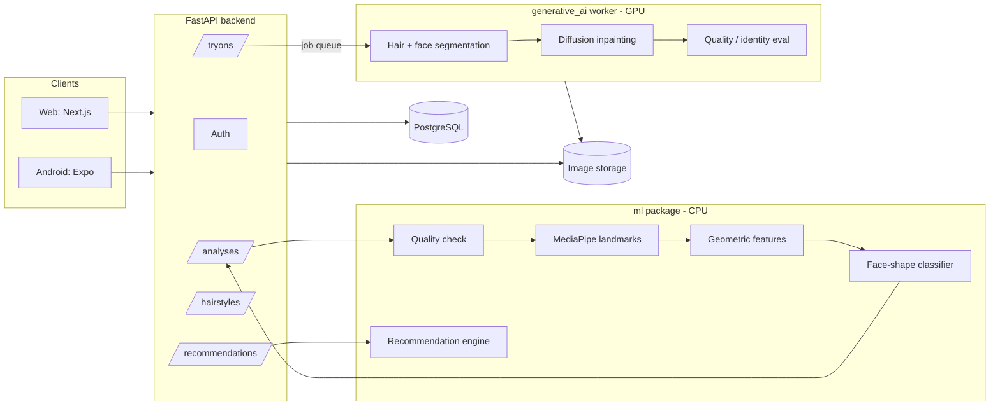

# Architecture

## Principles

- **ML is a library, not a service detail.** `ml/` and `generative_ai/` are importable Python packages with typed interfaces. The backend calls them; it never contains CV/ML logic.
- **Try-on is isolated.** Generative AI runs in its own worker process (GPU), queued, so a slow or failed generation never blocks analysis or recommendation.
- **No fake output.** Every confidence, score and metric shown in the UI comes from a real computation; endpoints return an explicit error/"not available" instead of placeholders.
- **Privacy by default.** Images are processed in memory; stored only after explicit consent; deletable; never logged.

## Components

## Request flows

**Analysis** (synchronous, target < 2 s on CPU): upload → quality gates (one face, size, blur, pose) → landmarks → normalized features → classifier (rule baseline first, ML model once evaluated) → result with per-class probabilities, measurements and landmark overlay → stored only if `consent=true`.

**Recommendation** (synchronous): face shape + hair type/thickness/length/style category/preferences → metadata filter → transparent weighted score per rule (each rule contributes a named, documented term) → rank → top 5 with explanation built from the rules that fired. The score is a rule score, not a probability, and is labeled as such.

**Try-on** (asynchronous): POST creates a job → GPU worker segments hair, builds masks, runs inpainting → stores output + evaluation metrics → client polls `/tryons/{id}`.

## Backend modules

| Module | Responsibility |
|---|---|
| `api/` | Routers: auth, analyses, recommendations, hairstyles, tryons, history, consent/deletion |
| `services/` | Orchestration; calls `ml` / enqueues `generative_ai` jobs |
| `schemas/` | Pydantic request/response models (also the OpenAPI docs) |
| `database/` | SQLAlchemy 2 models, Alembic migrations |

Job queue: start with a PostgreSQL-backed table polled by the worker (no extra infra); move to Redis + RQ/Celery only if needed.

## Data model (PostgreSQL)

| Table | Key columns |
|---|---|
| users | id, email, password_hash, created_at |
| face_analyses | id, user_id FK, image_path (nullable, only with consent), consent_given_at, predicted_shape, class_probabilities JSONB, model_version, quality_flags JSONB, created_at |
| facial_features | analysis_id FK 1:1, face_length, forehead_width, cheekbone_width, jaw_width, ratios…, forehead_visible bool |
| hairstyles | id, slug, name_id, gender_category, length, suitable_hair_types[], thickness[], attributes JSONB, reference_image_path, image_license |
| hairstyle_compatibility | hairstyle_id FK, face_shape, weight, rationale_id (documented rule) |
| recommendations | id, analysis_id FK, hairstyle_id FK, rank, score, score_breakdown JSONB, explanation |
| virtual_tryons | id, user_id FK, analysis_id FK nullable, hairstyle_id FK, status, input_image_path, output_image_path, metrics JSONB, model_name, created_at |
| model_experiments | id, name, dataset_version, split_strategy, params JSONB, metrics JSONB, git_sha, seed, created_at |

Indexes on all FKs, `face_analyses(user_id, created_at)`, `hairstyles(gender_category, length)`, `virtual_tryons(status)`. Deleting an analysis or user cascades to rows **and files**.

## Image handling

- Validate MIME/magic bytes, max size, re-encode (strips EXIF/GPS).
- Files stored under random UUID names outside the web root, served via authenticated, short-lived URLs.
- Logging filter forbids image bytes/base64 and paths in logs.

## Face-shape method (Phase 2 detail in `research/methodology/face-shape-features.md`)

Features are distances between MediaPipe landmarks divided by a scale reference (face width or inter-ocular distance), so they are scale-invariant; roll is removed by aligning on eye centers. The forehead is the weakest measurement: MediaPipe's topmost landmark (≈ 10) sits below the hairline, and bangs hide the forehead, so `forehead_visible` is estimated from the hair mask and the classifier must work (with lower confidence) when it is false.
