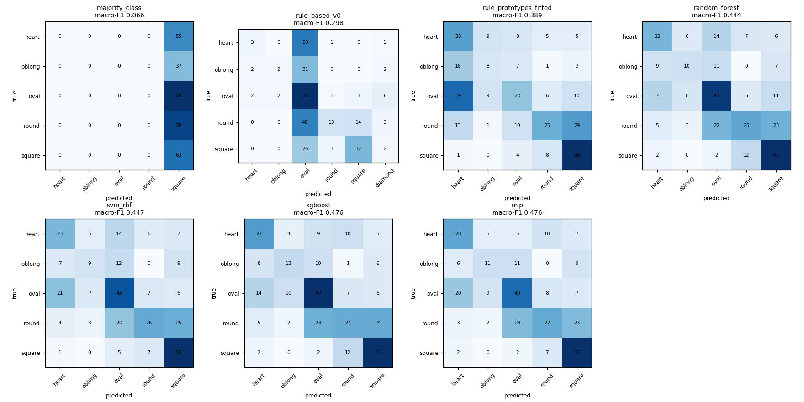
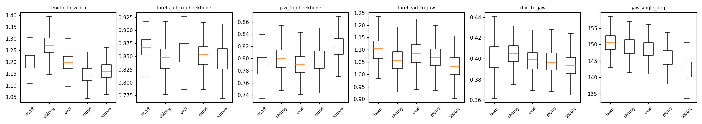

# Phase 3 results: niten19

Generated by `python -m ml.training.train_face_shape`; every number below comes from that run (`metrics.json`).

- Images: 5000; passed quality gates: 2977; used: 2977
- Rejection reasons (an image can have several): {'face_too_small': 1341, 'head_tilted_vertically': 846, 'image_too_small': 615, 'head_turned': 94, 'blurry': 24, 'face_cut_off': 8, 'head_tilted': 3, 'decode_error': 2}
- Class counts used: {'heart': 505, 'oblong': 508, 'oval': 600, 'round': 663, 'square': 701}
- Identity groups (SFace, cosine >= 0.363): 250; largest group: 98 images
- Source test images sharing an identity group with source train: 564 of 586
- Protocol: identity-aware stratified hold-out (1 of 5 folds) + 5-fold identity-aware stratified CV on the rest; seed 42; train 2660, test 317

- Test class counts: {'heart': 55, 'oblong': 37, 'oval': 84, 'round': 78, 'square': 63}
- Identity groups holding more than one face-shape label: 46 (983 images); a sign of label noise or of grouping errors

| Model | CV macro-F1 (mean ± std) | Test accuracy | Test macro-P | Test macro-R | Test macro-F1 (95% CI) |
|---|---|---|---|---|---|
| majority_class | 0.057 ± 0.026 | 0.199 | 0.040 | 0.200 | 0.066 (0.054-0.078) |
| rule_based_v0 | 0.333 ± 0.056 | 0.379 | 0.523 | 0.323 | 0.298 (0.243-0.346) |
| rule_prototypes_fitted | 0.495 ± 0.053 | 0.413 | 0.412 | 0.416 | 0.389 (0.336-0.444) |
| random_forest | 0.512 ± 0.024 | 0.470 | 0.454 | 0.455 | 0.444 (0.386-0.499) |
| svm_rbf | 0.512 ± 0.017 | 0.476 | 0.465 | 0.460 | 0.447 (0.389-0.500) |
| xgboost | 0.508 ± 0.024 | 0.495 | 0.481 | 0.486 | 0.476 (0.415-0.531) |
| mlp | 0.521 ± 0.018 | 0.498 | 0.485 | 0.491 | 0.476 (0.417-0.530) |

Selected model: **mlp** (highest CV macro-F1 among RF, SVM, XGBoost and MLP; the test set was not used for selection).

Bootstrap intervals resample test images, not people, so they understate uncertainty. Probabilities from these models are not calibrated.

