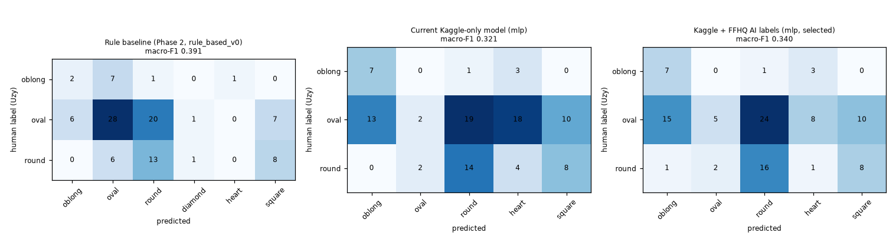

# Phase 3b results: Kaggle niten19 + FFHQ AI pseudo-labels, tested on human FFHQ labels

Generated by `python -m ml.training.train_face_shape_ffhq`; every number below comes from that run (`metrics.json`).

- Kaggle images used: 3244 (train 2562, hold-out 682); hold-out class counts: {'heart': 154, 'oblong': 117, 'oval': 129, 'round': 193, 'square': 89}
- FFHQ rows (usable labels only): {'test': 104, 'train': 364}; passed the current quality gates: {'test': 101, 'train': 343}; rejection reasons: {'too_bright': 24, 'eyes_covered': 4}
- FFHQ AI pseudo-labels used for training: 288 {'diamond': 3, 'heart': 18, 'oblong': 51, 'oval': 84, 'round': 100, 'square': 32} (55 dropped for sharing an identity group with a test photo)
- FFHQ human test (Uzy's labels, one annotator, never trained on): 101 {'oblong': 11, 'oval': 62, 'round': 28}
- Protocol: identity-aware stratified Kaggle hold-out (1 of 5 folds), shared by both configurations; 5-fold identity-aware stratified CV on each training set; FFHQ human test never trained on; seed 42
- Macro-F1 on the human test: unweighted mean F1 over the shapes in the human labels (oblong, oval, round); predictions of other shapes count as errors

## Headline: FFHQ human test

| Model | Trained on | FFHQ human macro-F1 (95% CI) | FFHQ accuracy | Kaggle hold-out macro-F1 (95% CI) |
|---|---|---|---|---|
| Rule baseline (Phase 2, rule_based_v0) | nothing (hand-written) | 0.391 (0.288-0.503) | 0.426 | 0.325 (0.288-0.360) |
| Current Kaggle-only model (mlp) | niten19 (2660 images) | 0.321 (0.212-0.407) | 0.228 | n/a |
| Kaggle + FFHQ AI labels (mlp, selected) | Kaggle train + FFHQ AI (2850 images) | 0.340 (0.240-0.432) | 0.277 | 0.517 (0.482-0.552) |

Confusion matrices (rows: Uzy's label, columns: prediction):

**Rule baseline (Phase 2, rule_based_v0)**

| true \ predicted | oblong | oval | round | diamond | heart | square |
|---|---|---|---|---|---|---|
| oblong | 2 | 7 | 1 | 0 | 1 | 0 |
| oval | 6 | 28 | 20 | 1 | 0 | 7 |
| round | 0 | 6 | 13 | 1 | 0 | 8 |

Per-class F1: oblong 0.211, oval 0.544, round 0.419

**Current Kaggle-only model (mlp)**

| true \ predicted | oblong | oval | round | heart | square |
|---|---|---|---|---|---|
| oblong | 7 | 0 | 1 | 3 | 0 |
| oval | 13 | 2 | 19 | 18 | 10 |
| round | 0 | 2 | 14 | 4 | 8 |

Per-class F1: oblong 0.452, oval 0.061, round 0.452

**Kaggle + FFHQ AI labels (mlp, selected)**

| true \ predicted | oblong | oval | round | heart | square |
|---|---|---|---|---|---|
| oblong | 7 | 0 | 1 | 3 | 0 |
| oval | 15 | 5 | 24 | 8 | 10 |
| round | 1 | 2 | 16 | 1 | 8 |

Per-class F1: oblong 0.412, oval 0.145, round 0.464

## Every candidate

| Config | Model | CV macro-F1 (mean ± std) | Kaggle hold-out macro-F1 (95% CI) | FFHQ human macro-F1 (95% CI) |
|---|---|---|---|---|
| kaggle_only | majority_class | 0.062 ± 0.021 | 0.046 (0.038-0.054) | 0.000 (0.000-0.000) |
| kaggle_only | rule_based_v0 | 0.330 ± 0.034 | 0.321 (0.284-0.354) | 0.400 (0.295-0.510) |
| kaggle_only | rule_prototypes_fitted | 0.471 ± 0.056 | 0.411 (0.374-0.447) | 0.286 (0.191-0.378) |
| kaggle_only | random_forest | 0.494 ± 0.033 | 0.485 (0.447-0.521) | 0.370 (0.255-0.466) |
| kaggle_only | svm_rbf | 0.497 ± 0.044 | 0.509 (0.470-0.547) | 0.254 (0.161-0.341) |
| kaggle_only | xgboost | 0.499 ± 0.033 | 0.533 (0.495-0.571) | 0.333 (0.228-0.434) |
| kaggle_only | mlp (selected) | 0.503 ± 0.053 | 0.536 (0.499-0.573) | 0.319 (0.215-0.411) |
| kaggle_plus_ffhq_ai | majority_class | 0.043 ± 0.021 | 0.046 (0.038-0.054) | 0.000 (0.000-0.000) |
| kaggle_plus_ffhq_ai | rule_based_v0 | 0.321 ± 0.038 | 0.321 (0.284-0.354) | 0.400 (0.295-0.510) |
| kaggle_plus_ffhq_ai | rule_prototypes_fitted | 0.387 ± 0.045 | 0.417 (0.380-0.451) | 0.333 (0.234-0.422) |
| kaggle_plus_ffhq_ai | random_forest | 0.443 ± 0.044 | 0.505 (0.468-0.541) | 0.407 (0.294-0.507) |
| kaggle_plus_ffhq_ai | svm_rbf | 0.447 ± 0.032 | 0.521 (0.483-0.559) | 0.395 (0.293-0.486) |
| kaggle_plus_ffhq_ai | xgboost | 0.452 ± 0.039 | 0.536 (0.497-0.573) | 0.386 (0.282-0.479) |
| kaggle_plus_ffhq_ai | mlp (selected) | 0.459 ± 0.044 | 0.517 (0.482-0.552) | 0.340 (0.240-0.432) |

Selection: highest CV macro-F1 among RF, SVM, XGBoost and MLP; no test set was used for selection.

The headline rule baseline is `ml.classification.rule_based.classify` as the app runs it, dropping the forehead features when hair covers the forehead (15 human test photos); the `rule_based_v0` rows above always use all six features, as in Phase 3.

`kaggle_only` is retrained here on the current feature table so it differs from the Kaggle+FFHQ run only by the added FFHQ rows; the committed Kaggle-only artifact was trained on an older feature table (quality gates have changed since), so its numbers are reported separately. Its Kaggle hold-out score is n/a here because that older split differs and overlaps this hold-out; see `research/results/phase3/kaggle_niten19`.

Bootstrap intervals resample test images, not people. The human test has a single annotator, so label reliability is unknown; the AI training labels are pseudo-labels, not ground truth. Probabilities are not calibrated.
